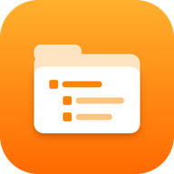

# AIDevance File Manager — file manager for Android

**[Download the latest version](https://github.com/AIDevance/aidevance-file-manager-releases/releases/latest/download/AIDevance-File-Manager.apk)** · [All releases](https://github.com/AIDevance/aidevance-file-manager-releases/releases) · [Site](https://aidevance.github.io/) · [Русский ниже](#aidevance-file-manager--файловый-менеджер-для-android)

A file manager for Android built like Windows Explorer: the roots of every storage place in one tree, and the same actions everywhere. By **AIDevance**.

> Early version. It works with the phone's memory today; the private zone (Samsung Secure Folder and its counterparts), Google Drive of connected accounts and the memory card come in the next versions.

## What it does now

- The phone's memory as a tree of folders, like Windows Explorer.
- View, open, copy, move, rename, delete; share through the apps installed on the phone.
- Trash: deleted files can be brought back.
- Search and recent files.

## Coming next

- The private zone — Secure Folder on Samsung, "Private space" on Android 15+ and the like — in the same tree.
- Google Drive of every connected account.
- The memory card.
- Google Play.

## Install

Android 8 and newer. Open `AIDevance-File-Manager.apk` on the phone and allow installing from this source if the phone asks. At first start, allow "All files access" — a file manager needs it to see the phone's folders.

## Verify the file

Every release lists the SHA-256 of the APK.

---

# AIDevance File Manager — файловый менеджер для Android

**[Скачать последнюю версию](https://github.com/AIDevance/aidevance-file-manager-releases/releases/latest/download/AIDevance-File-Manager.apk)** · [Все выпуски](https://github.com/AIDevance/aidevance-file-manager-releases/releases) · [Сайт](https://aidevance.github.io/)

Файловый менеджер для Android, устроенный как Проводник Windows: корни всех мест хранения в одном дереве и одинаковые действия везде. От **AIDevance**.

> Ранняя версия. Сейчас работает с памятью телефона; закрытая зона (Secure Folder у Samsung и аналоги), Google Drive подключённых аккаунтов и карта памяти — в следующих версиях.

## Что умеет сейчас

- Память телефона деревом папок, как в Проводнике Windows.
- Смотреть, открывать, копировать, переносить, переименовывать, удалять; делиться через установленные программы.
- Корзина: удалённое можно вернуть.
- Поиск и недавние файлы.

## Что дальше

- Закрытая зона — Secure Folder у Samsung, «Личное пространство» в Android 15+ и подобные — в том же дереве.
- Google Drive каждого подключённого аккаунта.
- Карта памяти.
- Google Play.

## Установка

Android 8 и новее. Откройте `AIDevance-File-Manager.apk` на телефоне и разрешите установку из этого источника, если телефон спросит. При первом запуске разрешите «Доступ ко всем файлам» — без него файловый менеджер не видит папки телефона.

## Проверка файла

В каждом выпуске указан SHA-256 файла APK.
